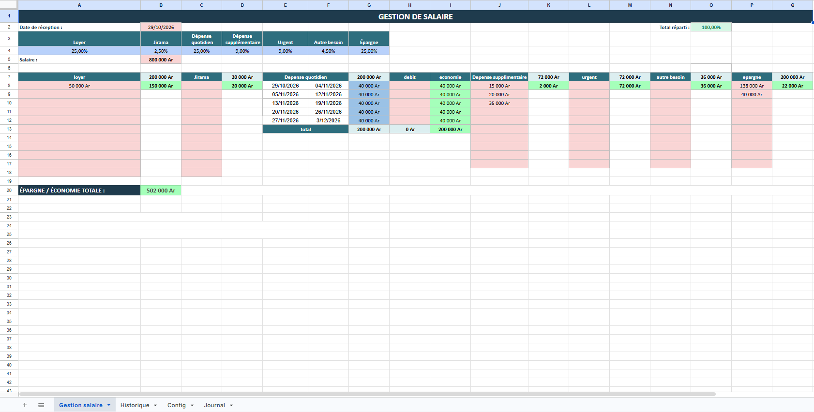

# Gestion Salaire Bot

Bot Telegram en langage naturel pour gérer un budget salaire dans Google Sheets, 100 % gratuit, écrit en Google Apps Script.

Tu écris au bot comme à une personne (« j'ai dépensé 15 000 Ar en légumes », « combien me reste-t-il pour la semaine ? »). L'IA comprend le message, répond aux questions sur le contenu de ton fichier, et propose d'écrire dans le Sheet. **Aucune écriture n'a lieu sans ta confirmation.**

## Fonctionnalités

- Saisie de dépenses et de données en langage naturel
- Questions libres sur le contenu du fichier (totaux, tendances, anomalies, conseils budgétaires)
- Confirmation par boutons (Confirmer / Annuler) avant toute écriture
- Plusieurs tableaux pilotés par une feuille `Config`
- IA gratuite : Groq en priorité, Google Gemini en secours
- Accès limité à ton compte Telegram (liste blanche de chat id)
- Protection contre les doublons de messages Telegram

## Aperçu du tableau

Voici la feuille « Gestion salaire » que le bot lit et met à jour :



## Architecture

```
Telegram  ->  Web App Apps Script (doPost)  ->  Code.gs
                                                  |-- Telegram.gs  (envoi, boutons)
                                                  |-- AI.gs        (Groq, puis Gemini)
                                                  |-- SheetOps.gs  (lecture / écriture Sheet)
                                                  `-- Config.gs    (clés, feuille Config)
```

| Fichier | Rôle |
|---|---|
| `Config.gs` | Constantes, lecture des clés (Script Properties), lecture de la feuille `Config` |
| `Telegram.gs` | Appels à l'API Telegram, messages, clavier de confirmation, `setWebhook` |
| `AI.gs` | Appels Groq et Gemini, bascule automatique en cas d'erreur |
| `SheetOps.gs` | Instantané du Sheet pour l'IA, ajout de lignes, modification de cellules |
| `Code.gs` | Point d'entrée `doPost`, logique de conversation, prompts, fonctions de test |
| `appsscript.json` | Manifeste Apps Script (fuseau horaire, permissions, accès web) |

## Prérequis

- Un compte Google et ton Google Sheets `gestion_salaire` (converti en Google Sheets si c'est un .xlsx)
- Un bot Telegram créé avec [@BotFather](https://t.me/BotFather) (récupère le token)
- Une clé API gratuite [Groq](https://console.groq.com/keys) (priorité)
- Une clé API gratuite [Google AI Studio](https://aistudio.google.com/apikey) (Gemini, secours)
- Ton chat id Telegram (envoie un message à [@userinfobot](https://t.me/userinfobot))

## Installation

1. Ouvre ton Google Sheets, puis **Extensions > Apps Script**.
2. Crée les fichiers `Config.gs`, `Telegram.gs`, `AI.gs`, `SheetOps.gs`, `Code.gs` et colle le contenu correspondant.
3. **Paramètres du projet > Propriétés du script**, ajoute :

   | Propriété | Valeur |
   |---|---|
   | `TELEGRAM_TOKEN` | token donné par BotFather |
   | `GROQ_API_KEY` | clé Groq |
   | `GEMINI_API_KEY` | clé Gemini |
   | `ALLOWED_CHAT_ID` | ton chat id (plusieurs possibles, séparés par des virgules) |
   | `WEB_APP_URL` | URL du déploiement (étape 5), à ajouter après le déploiement |

   Propriétés optionnelles : `GROQ_MODEL`, `GEMINI_MODEL` (changer de modèle si un modèle est retiré), `SPREADSHEET_ID` (si le script n'est pas lié au classeur). Le secret du webhook (`WEBHOOK_SECRET`) est généré automatiquement.

4. Exécute la fonction `setupConfigSheet` une fois (autorise les permissions). Elle crée la feuille `Config` avec un exemple.
5. **Déployer > Nouveau déploiement > Application Web** :
   - Exécuter en tant que : **Moi**
   - Qui a accès : **Tout le monde**
   - Copie l'URL se terminant par `/exec` dans la propriété `WEB_APP_URL`.
6. Exécute la fonction `setWebhook` (elle ajoute un secret à l'URL pour rejeter les appels qui ne viennent pas de Telegram). Vérifie avec `webhookInfo`.
7. Écris `/start` à ton bot.

Fonctions de test dans l'éditeur : `testSnapshot` (ce que l'IA voit du classeur) et `testAI` (chaîne IA complète sans Telegram).

Le fichier `appsscript.json` (fuseau horaire, permissions, accès web) est le manifeste : affiche-le via **Paramètres du projet > Afficher le fichier manifeste** et remplace son contenu si tu veux la même configuration.

> À chaque modification du code, refais **Déployer > Gérer les déploiements > Modifier > Nouvelle version**, sinon le webhook garde l'ancienne version.

## La feuille Config

Chaque ligne déclare un tableau que le bot peut lire et remplir :

| Table | Feuille | LigneEntete | Description |
|---|---|---|---|
| depenses | Gestion salaire | 1 | Dépenses par catégorie et par semaine |

- **Table** : nom court utilisé par l'IA
- **Feuille** : nom exact de l'onglet
- **LigneEntete** : numéro de la ligne contenant les titres de colonnes
- **Description** : aide l'IA à comprendre à quoi sert le tableau

Pour ajouter un tableau, ajoute simplement une ligne. Aucun code à changer.

## Exemples d'utilisation

- « J'ai payé le Jirama 45 000 Ar » : le bot propose une écriture, tu confirmes
- « Combien j'ai dépensé en quotidien cette semaine ? » : réponse directe
- « Où est-ce que je dépense trop ? » : analyse et conseils
- `/aide` : liste des commandes

## Sécurité

- Les clés ne sont **jamais** dans le code : uniquement dans les Propriétés du script.
- Seuls les chat id listés dans `ALLOWED_CHAT_ID` reçoivent une réponse.
- L'URL du webhook contient un secret : un appel sans ce secret est ignoré.
- Les écritures sont toujours soumises à confirmation, puis re-validées juste avant d'être appliquées.
- Le bot ne modifie jamais une cellule contenant une formule et refuse toute valeur commençant par `=`.
- Seuls les tableaux déclarés dans la feuille `Config` sont accessibles.
- Ne publie jamais tes clés sur Git (voir `.gitignore`).

## Limites connues

- Apps Script limite la durée d'exécution (6 min) et le nombre d'appels externes par jour ; largement suffisant pour un usage personnel.
- Les paliers gratuits de Groq et Gemini ont des quotas ; le bot bascule sur Gemini si Groq échoue.
- Les montants stockés en texte (« 0 Ar ») sont écrits tels quels : adapte la mise en forme si tu veux des nombres.
- Les ajouts de ligne (`append`) se font à la première ligne libre sous la dernière ligne utilisée de la feuille ; pour une feuille à structure libre (comme le suivi hebdomadaire), le bot modifie plutôt une cellule précise (`update`).
- L'IA ne lit que les 60 dernières lignes et 20 premières colonnes de chaque tableau (réglable dans `Config.gs`).
- Ce code n'a pas pu être exécuté dans Apps Script depuis ici : seule la syntaxe et les fonctions utilitaires ont été testées. Fais `testSnapshot` puis `testAI` avant de brancher Telegram.
- L'IA peut se tromper : relis toujours le résumé avant de confirmer.

## Déploiement avec clasp (optionnel)

```bash
npm install -g @google/clasp
clasp login
clasp clone <SCRIPT_ID>
clasp push
```

## Licence

À définir (MIT recommandé pour un projet personnel).
